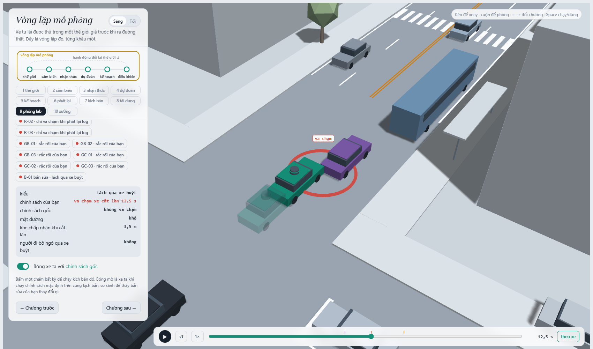
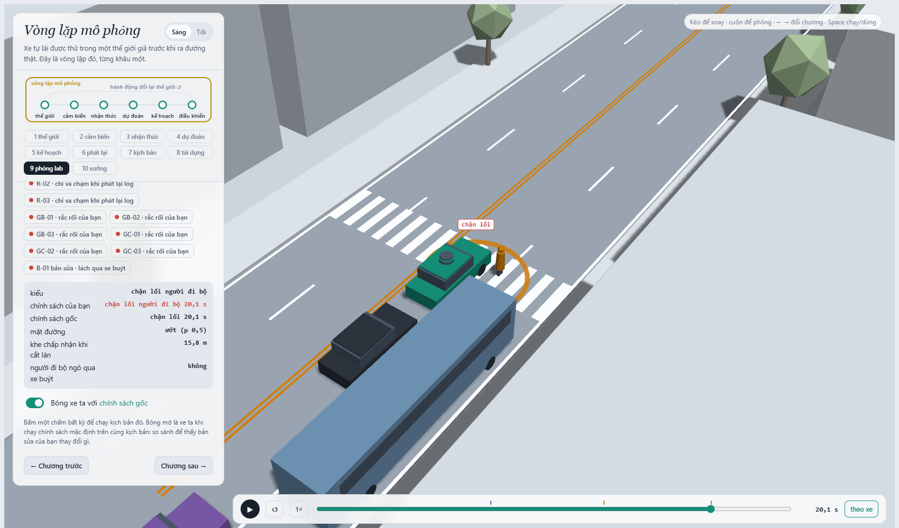
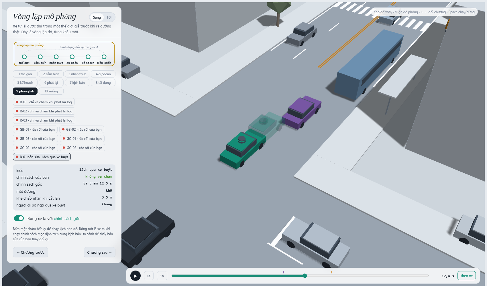
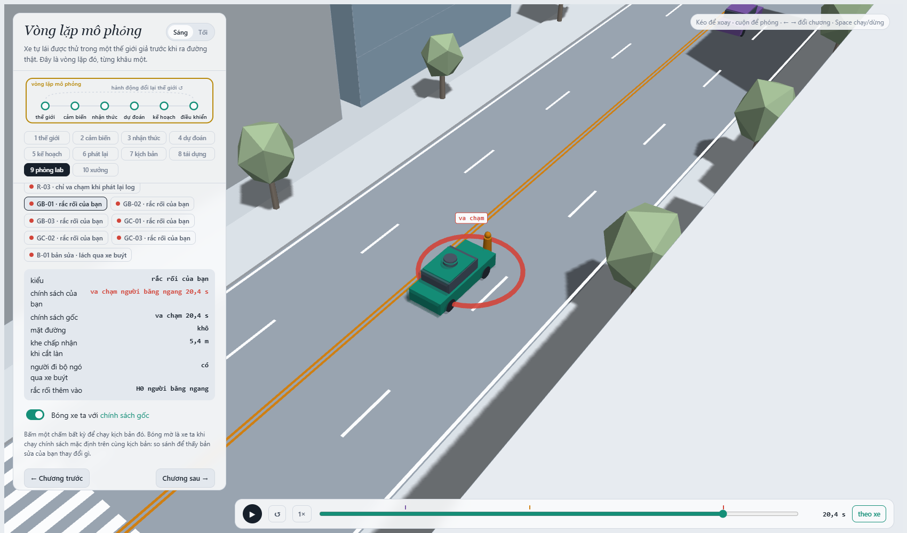

MSSV: 202602781

# Lab 11 · Scenario Forge — báo cáo

Mỗi câu: trả lời ngắn, **trích số từ `evidence/`** (ghi tên file và trường, ví dụ `mc.json: crashes = 4`). Grader chạy lại với MSSV của bạn; số không khớp `evidence/` thì mất điểm phần D (RUBRIC), và câu dựa trên số sai khó được điểm đầy đủ. Không cần văn hay: một bảng nhỏ và hai, ba câu giải thích là đủ.

Thị trấn của bạn (`meta.json: _run.town`): **C** (người chuyển làn liều hơn: khe chấp nhận trung vị 10 m; ít người ngó qua xe buýt hơn: 0,80). Mọi số dưới đây lấy từ lần chạy đầy đủ ngân sách (không `--quick`, `meta.json: steps.*.quick = false`).

## 1. Phát lại log có trung thực không? (bước A)

Trong `replay.json`: bao nhiêu kịch bản bị bỏ vì người lái gây va chạm, bao nhiêu va chạm khi planner chạy trên log phát lại, bao nhiêu trong thế giới phản ứng, theo từng loại tiếp xúc. Giải thích vì sao phần lớn va chạm của "phát lại" là `rear`, và vì sao đó là va chạm **giả**. Chọn một kịch bản trong `replay_only` và nói chuyện gì đã xảy ra.

| `replay.json` | giá trị |
|---|---|
| `n` / `dropped_human_crash_logs` / `n_used` | 400 / **0** / 400 |
| `replay.crashes` (theo `contact`) | **139** (`rear` 121, `side` 18) |
| `reactive.crashes` (theo `contact`) | **2** (`front` 1, `side` 1) |
| `crash_in_both` | 2 |

Không log nào bị bỏ (người lái trong log không tự gây va chạm lần nào trong 400 kịch bản). Trên log phát lại planner "va chạm" 139 lần, trong thế giới phản ứng chỉ 2 lần, và cả 2 vụ đó cũng có trong bản phát lại. 121/139 vụ của bản phát lại là `rear`: xe phía sau (chủ yếu xe bám đuôi TG) chạy **đúng như trong log**, tức là bám theo người lái thật. Planner của tôi thận trọng hơn người lái (giảm tốc gần vạch bị xe buýt che, dừng nhường người đi bộ sớm hơn), nên nó chậm lại ở những chỗ người lái không chậm. Xe phía sau trong log không biết planner phanh sớm hơn, nên không phanh theo và đâm vào đuôi. Đó là va chạm **giả**: ngoài đời xe sau nhìn thấy và phản ứng. Trong thế giới phản ứng, những kịch bản đó không có va chạm nào.

Ví dụ `replay_only[0]` (kịch bản 4, `contact = rear`, `min_ttc_reactive = 2,49 s`; TG bám rất sát, `tgT = 0,63 s`). Tôi chạy lại kịch bản này để xem chi tiết. Lúc t ≈ 13,5 s planner đang ở chế độ thận trọng (7,2 m/s, vì vạch qua đường bị xe buýt che), trong khi người lái trong log đã chạy 9,5 m/s và vẫn tăng tốc. Lúc t ≈ 15,5 s planner phanh gấp (−7,85 m/s²) rồi dừng hẳn để nhường người đi bộ. TG phát lại vẫn giữ 6,0 m/s như trong log (người lái thật khi đó đang chạy 10,5 m/s, không cần TG phanh) và đâm vào đuôi xe ta lúc t = 16,55 s. Trong thế giới phản ứng, cùng TG đó giảm xuống 4,1 m/s và không có va chạm.

## 2. Kịch bản bất khả thi (bước B)

Liệt kê các luật trong `is_feasible` và căn cứ vật lý của từng luật (ma sát, gia tốc, tốc độ người). Trong `hunt.json`, cuộc săn nào sinh nhiều kịch bản bất khả thi nhất, và vì sao CEM lại bị kéo về phía đó? Điều gì xảy ra với ước lượng nếu bạn **đếm** chúng là va chạm?

| Luật (loại nếu…) | Căn cứ vật lý |
|---|---|
| a_lat = (π/cutDur)²·3,5/2 > μg | Đổi làn 3,5 m theo đường cosine trong `cutDur` giây cần gia tốc ngang đỉnh như vậy; lốp chỉ cho tối đa μg lực ngang (khô 0,8·9,81 = 7,85 m/s², ướt 4,9 m/s²). Vượt mức đó xe trượt, không thể đổi làn kiểu đó. |
| cutBrake > μg | Phanh dọc cũng bị giới hạn bởi ma sát lốp: không xe nào phanh mạnh hơn μg. |
| pedV > 2,5 m/s | Người đi bộ bình thường 1,2–1,5 m/s; trên 2,5 m/s là chạy nước rút, không còn là "người đi bộ qua đường". |
| cutV ∉ (0, 22] m/s | Xe chuyển làn phải đang chạy (> 0) và không vượt ~80 km/h trên phố đô thị này. |

`hunt.json: infeasible`: `bus_bypass` 4, `cut_in` 1, `crosswalk_block` 10, `rear_ended` **11**. Cả 26 kịch bản bất khả thi đều vi phạm luật bám ngang khi đổi làn (tôi phân loại lại từ `cloud.json`). 88 % trong số đó là đường ướt, và chúng dồn vào các vòng cuối của cuộc săn `crosswalk_block` và `rear_ended`. Lý do: điểm nguy hiểm của hai kiểu này tăng khi đường ướt (quãng phanh dài hơn), nên CEM đẩy xác suất đường ướt lên (`hunt.json: crosswalk_block.proposal.p_bin[0] = 0,95`, `rear_ended` 0,60, so với 0,20 tự nhiên). Mà khi μ = 0,5 thì ngưỡng khả thi của một lần đổi làn tăng từ cutDur ≥ 1,48 s lên ≥ 1,88 s, nên những lần đổi làn nhanh vốn hợp lệ trên đường khô trở thành bất khả thi. Vùng "nguy hiểm" và vùng "bất khả thi" nằm sát nhau (cùng là ít ma sát), nên q trượt dần qua ranh giới.

Nếu **đếm** chúng là va chạm: (i) xác suất bị cộng thêm những thất bại không thể xảy ra, nên ước lượng bị lệch lên; (ii) tệ hơn, chúng sẽ được điểm nguy hiểm tối đa (0), CEM sẽ giữ chúng trong elite, và q co về vùng phi vật lý thay vì vùng va chạm thật. Khi đó cả cuộc săn và trọng số IS đều mô tả một thế giới không tồn tại. (Lần chạy thêm, ngoài `evidence/`: mô phỏng cưỡng bức 26 kịch bản này thì 0/26 kết thúc bằng thất bại của xe ta, và điểm nguy hiểm trung vị của chúng không cao hơn các kịch bản khả thi cùng vòng. Ở seed của tôi, CEM bị kéo về phía bất khả thi gián tiếp qua đường ướt, không phải vì chính chúng đã va chạm.)

## 3. Monte Carlo cho bạn biết gì (bước C1)

`mc.json`: k, n, p̂ và khoảng Wilson 95 %. Với p̂ đó, cần bao nhiêu lần chạy để khoảng tin cậy hẹp lại còn ±20 % của p? Có kiểu thất bại nào **chưa hề xuất hiện** trong 3 000 lần chạy không? Con số đúng cần báo cho kiểu đó là gì?

`mc.json`: `crashes` k = **5**, `n` = **3000**, `p` = **1,67·10⁻³**, Wilson 95 % [`lo` **7,12·10⁻⁴**, `hi` **3,90·10⁻³**]; `modes = {bus_bypass: 5}`; `infeasible` = 11 kịch bản không chạy.

Để nửa độ rộng khoảng còn ±20 % của p: 1,96·√(p(1−p)/n) = 0,2·p ⇒ n = (1,96/0,2)²·(1−p)/p ≈ **96/p**. Với p̂ = 1,67·10⁻³ thì n ≈ 57 600 lần chạy. Nếu p thật gần ước lượng IS (~8·10⁻⁴, câu 4) thì cần ≈ 120 000. Hiện tại khoảng Wilson rộng gấp ~5,5 lần (3,9·10⁻³ / 7,1·10⁻⁴).

Bốn kiểu `cut_in`, `crosswalk_block`, `rear_ended` và `other` **chưa hề xuất hiện** (k = 0). Không được báo 0. Con số đúng là cận trên Wilson 95 % với k = 0: `mc.json: per_mode.<kiểu>.hi` = **1,28·10⁻³** (xấp xỉ quy tắc 3/n = 1·10⁻³). Nghĩa là 3 000 lần chạy chỉ cho phép nói "mỗi kiểu này < 1,3·10⁻³", và chuyện đó vẫn có thể lớn hơn tần suất `bus_bypass` thật.

## 4. Importance sampling, ESS và độ suy biến (bước C3)

Bảng: với từng kiểu và từng seed trong `estimate.json`, ghi `p`, `hits`, `ess`, `top_share`. Ba seed có đồng ý với nhau không, và có đồng ý với Monte Carlo không? Ở đâu `top_share` lớn (> 0,5), và vì sao khi đó con số thực ra chỉ là trọng số của một mẫu? So ngân sách (`budget`) với số lần chạy Monte Carlo cần để có cùng độ chính xác. Phần `other` trong tổng lấy từ đâu, và vì sao không săn nó?

`estimate.json` (mỗi ô: `p` · `hits` · `ess` · `top_share`; n = 600 mẫu mỗi kiểu mỗi seed):

| kiểu | seed 0 | seed 1 | seed 2 |
|---|---|---|---|
| `bus_bypass` | 9,99·10⁻⁴ · 58 · 129 · 0,24 | 7,78·10⁻⁴ · 53 · 146 · 0,23 | 7,73·10⁻⁴ · 56 · 121 · 0,15 |
| `cut_in` | 0 · 0 · 124 · 0 → cận `upper_zero_hits` 0,025 | 0 · 0 · 119 · 0 → 0,025 | 0 · 0 · 122 · 0 → 0,025 |
| `crosswalk_block` | 1,82·10⁻⁵ · 37 · 108 · **0,99** | 5,67·10⁻⁷ · 46 · 114 · 0,27 | 4,06·10⁻⁶ · 44 · 120 · **0,96** |
| `rear_ended` | 0 · 0 · 101 · 0 → 0,025 | 0 · 0 · 120 · 0 → 0,025 | 0 · 0 · 119 · 0 → 0,025 |
| `total` [lo, hi] | 1,02·10⁻³ [3,99·10⁻⁴, 2,91·10⁻³] | 7,78·10⁻⁴ [3,17·10⁻⁴, 2,52·10⁻³] | 7,77·10⁻⁴ [3,99·10⁻⁴, 2,43·10⁻³] |

- **Đồng ý?** `bus_bypass` thì có: ba seed nằm trong 7,7–10·10⁻⁴, chênh ~30 %, `top_share` ≤ 0,24. Nó cũng khớp với Monte Carlo: nằm trong khoảng Wilson [7,1·10⁻⁴; 3,9·10⁻³] nhưng thấp hơn p̂ = 1,67·10⁻³ khoảng 1,7–2,1 lần, đúng như README cảnh báo (IS ở ngân sách này thường thấp hơn sự thật 1,5–4 lần). `crosswalk_block` thì **không**: ba seed chênh nhau **32 lần** (5,7·10⁻⁷ đến 1,8·10⁻⁵), dù mỗi seed có 37–46 hits.
- **`top_share` > 0,5** ở `crosswalk_block` seed 0 (0,99) và seed 2 (0,96). Từ chính các trường đó: ở seed 0, Σw·y = n·p = 600 × 1,82·10⁻⁵ ≈ 1,1·10⁻², trong đó một mẫu mang 0,99 × 1,1·10⁻² ≈ 1,08·10⁻². 36 hit còn lại cộng lại chỉ ≈ 1,5·10⁻⁴, trung bình ~4·10⁻⁶ mỗi hit: chúng nằm ngay giữa q, nơi p rất nhỏ so với q. Vậy p ≈ (trọng số của **một** mẫu)/600. Con số khi đó không phải "tần suất" mà là "có hay không rút trúng một mẫu nặng". Seed 1 không rút trúng mẫu nặng nào, nên ra 5,7·10⁻⁷, nhỏ hơn 30 lần. ESS ≈ 110 trông ổn nhưng không cứu được: ESS đo độ lệch của **mọi** trọng số, còn ước lượng chỉ do các mẫu có y = 1 quyết định. Đây là dấu hiệu README nói tới: cuộc săn tìm được **một** cách gây `crosswalk_block` (người đi bộ chậm, xe buýt rời bến sớm, đường ướt: `p_bin[0] = 0,95`, `pedLook` 0,03), nhưng chưa chắc là cách hay xảy ra nhất.
- **Ngân sách:** `budget = 16 800` lần chạy cho cả 4 kiểu (4 × (8·300 săn + 3·600 ước lượng)). Riêng `bus_bypass`, seed 2 đạt sai số tương đối se/p = 1,93·10⁻⁴ / 7,73·10⁻⁴ ≈ 25 % với 2 400 + 600 = 3 000 lần chạy. Monte Carlo cần n = (1−p)/(p·0,25²) ≈ **20 700** lần chạy để có cùng độ chính xác, tức gấp ~7 lần. Với `crosswalk_block` (p ~ 10⁻⁶–10⁻⁵), Monte Carlo cần cỡ 96/p ≈ 10⁷–10⁸ lần chạy, nghĩa là không làm nổi; IS thì cho ra một con số, nhưng như trên, chưa đáng tin.
- **`other`** lấy từ Monte Carlo C1: `estimate.json: other = {k: 0, n: 3000, p: 0, hi: 1,28·10⁻³, source: "mc.json"}`. Nó không được săn vì không có điểm nguy hiểm riêng (là phần "còn lại" của tập va chạm, không phải một cơ chế cụ thể để CEM bám theo), nhưng vẫn phải có trong tổng để phép chia kiểu là một phân hoạch đầy đủ. Vì k = 0, tổng không cộng 0 mà cộng cận Wilson 1,28·10⁻³ vào đầu trên (`hi`), nên `hi` của mọi seed là ~2,4–2,9·10⁻³.

## 5. Các kiểu thất bại (bước C2 + 3D)

Mỗi kiểu bạn tìm thấy: một ảnh chụp trình xem 3D (chương 9) ở đúng lúc va chạm, và một câu mô tả chuỗi sự kiện (ai thấy gì, ai chờ gì). Kiểu nào cuộc săn **không** tìm thấy, và bạn tin điều đó ở mức nào? Nếu chỉ chạy **một** cuộc săn chung cho mọi kiểu thì điều gì xảy ra (gợi ý: `hunt.json: found` của từng cuộc săn)?

Ảnh chụp chương 9 (mở `evidence/viewer.json`), dừng đúng lúc va chạm / chặn lối:

**`bus_bypass`** (`viewer.json` run B-01, đường khô, `cutGap` = 3,5 m):

Xe buýt đỗ ở làn ngoài; xe C2 (tím) bị kẹt phía sau, gần như dừng ở x ≈ 95 m. Lúc t = 10,75 s C2 bắt đầu lách sang làn xe ta để vượt xe buýt, vì nó chấp nhận một khe rất nhỏ (3,5 m), trong khi xe ta chỉ còn cách 10,7 m phía sau với 7,5 m/s (đang ở chế độ thận trọng vì vạch qua đường bị xe buýt che). Planner chỉ coi C2 là "xe phía trước" khi C2 đã lấn vào đủ sâu (lệch ngang < `cutinLat` = 2,15 m), tức t = 12,05 s, quá muộn. Hai xe chạm nhau lúc t = 12,45 s (xe ta 4,0 m/s, C2 1,8 m/s). Run này được ghim ở policy gốc (nơi nó được tìm thấy), nên xe đặc là policy gốc và bóng mờ là bản sửa: bóng mờ dừng lại phía sau, không chạm.

**`crosswalk_block`** (run C-01, đường ướt μ = 0,5, người đi bộ **không** ngó qua xe buýt):

Người đi bộ P1 bắt đầu bước qua lúc t = 14,6 s, khi xe ta ở x = 107 m, nhưng cảm biến xe ta không thấy vì xe buýt che, và P1 cũng không ngó nên không thấy xe ta. Xe ta chỉ thấy P1 lúc t = 15,65 s, khi còn cách vạch 7,3 m ở 7,4 m/s. Trên đường ướt quãng phanh tối thiểu đã là 5,6 m, nên xe dừng được nhưng mũi xe đã nằm trên vạch (dừng ở x = 120,1 m). P1 đi tới làn xe ta thì gặp thân xe chắn trước mặt và phải đứng lại: sự kiện `block` lúc t = 20,05 s (vòng cam "chặn lối" trong ảnh).

**Kiểu không tìm thấy:** `cut_in` và `rear_ended`.
- `hunt.json: cut_in.found = {bus_bypass: 34}`, vòng cuối `level = −2,79` (elite chưa bao giờ là va chạm `cut_in`).
- `hunt.json: rear_ended.found = {crosswalk_block: 14, bus_bypass: 3}`, `level = −1,19`.
- Thêm vào đó, Monte Carlo có 0/3000 cho cả hai (`mc.json: per_mode.*.hi = 1,28·10⁻³`), và IS có 0 hits ở cả 3 seed (`upper_zero_hits = 0,025`).

Tôi tin ở mức vừa phải rằng chúng hiếm (dưới ~10⁻³ theo cận Monte Carlo), nhưng **không** tin chúng bằng 0. Cận IS 0,025 rất yếu, và việc CEM không tìm ra chỉ có nghĩa là điểm nguy hiểm không dẫn được tới vùng đó (TTC nhỏ nhất của xe bám đuôi dừng ở ~1,2 s), không chứng minh vùng đó không tồn tại. Riêng `rear` thì có xuất hiện rất nhiều, nhưng chỉ trong bản **phát lại** (câu 1), tức là va chạm giả.

**Nếu chỉ chạy một cuộc săn chung:** chính hai cuộc săn trên đã cho thấy chuyện gì xảy ra. Cuộc săn `cut_in` trượt hẳn về `bus_bypass` (34/34 va chạm tìm được là `bus_bypass`), cuộc săn `rear_ended` trượt về `crosswalk_block`. CEM luôn co về kiểu **dễ gây va chạm nhất**: cuộc săn `bus_bypass` tìm được 202 va chạm, còn `crosswalk_block` chỉ 18. Một cuộc săn chung sẽ hội tụ về `bus_bypass`, đề xuất q gần như không còn mẫu ở vùng người đi bộ (p ~ 10⁻⁶), và ước lượng `crosswalk_block` sẽ dựa trên gần như không mẫu nào. Vì thế mỗi kiểu cần một cuộc săn riêng với điểm nguy hiểm riêng.

## 6. Sửa planner (bước E + 3D)

`fix.json`: policy được chọn, `fail` và `fail_hi` trên TRAIN, trên TEST (`fail_hi_seen` và `fail_hi`), và của policy gốc trên TEST; vì sao `fail_hi` của bản sửa có thể lớn hơn `fail` của policy gốc dù bản sửa tốt hơn thật? quãng đường và số lần phanh gấp. Một ảnh chụp 3D có **bóng mờ** (policy gốc) cho một kịch bản mà bản sửa tránh được. Có núm chỉnh nào "nghe thì an toàn hơn" nhưng thực tế làm tăng thất bại? Giải thích bằng cách thế giới phản ứng lại.

`fix.json: chosen.policy` = **`{"cutinLat": 3.0}`**: coi một xe đang lấn sang là xe phía trước ngay khi nó còn cách 3,0 m theo phương ngang, thay vì 2,15 m (chỉ khi đã chạm vạch làn).

| `fix.json` | `fail` | `fail_hi_seen` | `fail_hi` | `progress` [m] | `harsh` [khung/chuyến] | `unseen` |
|---|---|---|---|---|---|---|
| `baseline_train` | 7,49·10⁻⁴ | 1,51·10⁻³ | 1,51·10⁻³ | 212,0 | 8,46 | – |
| `chosen` (TRAIN) | 2,15·10⁻⁶ | 5,60·10⁻⁶ | 5,60·10⁻⁶ | 212,0 | 8,08 | `bus_bypass` |
| `chosen_test` | **1,02·10⁻⁶** | **1,86·10⁻⁶** | **3,88·10⁻²** | 210,4 | 8,19 | `bus_bypass` |
| `baseline_test` | 3,81·10⁻⁴ | 5,78·10⁻⁴ | 1,86·10⁻³ | 210,6 | 8,82 | – |

- **TRAIN chỉ để sàng.** Trên TRAIN, `cutinLat` 3,0 và 3,3 cùng có `fail_hi` = 5,60·10⁻⁶; `choose_policy` chọn 3,0 vì quãng đường lớn hơn (212,0 so với 211,9 m). Con số tôi báo là TEST: seed mới, và một cuộc săn **mới nhắm vào chính policy này**. Cuộc săn đó vẫn không tìm được vụ `bus_bypass` nào (`chosen_test.bus_bypass.hits = 0`, trong khi policy gốc có 51 hits trên TEST). Va chạm còn lại chỉ là `crosswalk_block` (1,02·10⁻⁶, giống hệt policy gốc, vì núm này không đụng tới người đi bộ). Không có va chạm "khác" trên 3 000 lần chạy tự nhiên (`other_crashes.k = 0`).
- **Vì sao `fail_hi` của bản sửa (3,88·10⁻²) lớn hơn cả `fail` của policy gốc (3,81·10⁻⁴), dù bản sửa tốt hơn thật?** Vì `bus_bypass` không còn xuất hiện, nên nó là kiểu `unseen` và phải cộng cận hợp lệ cho 0 hits: 3/(0,2·400) = **0,0375**, cộng `crosswalk_block` 1,86·10⁻⁶ và cận Wilson của va chạm khác 1,28·10⁻³ = 3,88·10⁻². Cận này do **ngân sách** quyết định, không phải do policy: với 400 mẫu, không cách nào chứng nhận một kiểu đã biến mất dưới ~10⁻². Dữ liệu cho thấy bản sửa tốt hơn (`fail_hi_seen` 1,86·10⁻⁶ so với 5,78·10⁻⁴), nhưng để **chứng nhận** p < 10⁻³ cần cỡ 15 000 lần chạy trên đúng vùng đó.
- **Giá phải trả:** quãng đường 210,4 so với 210,6 m (−0,1 %, trong giới hạn 5 %). Số khung phanh gấp còn **giảm**, 8,19 so với 8,82, vì xe ta bắt đầu giảm tốc sớm hơn và êm hơn khi C2 còn đang lách.

Ảnh có bóng mờ (run B-01; tôi bỏ ghim policy của run này khi xem, để xe đặc chạy **bản sửa** và bóng mờ chạy **policy gốc**), dừng lúc t = 12,45 s:

Bóng mờ (policy gốc) đâm vào C2 đang lách qua xe buýt. Xe đặc (`cutinLat` 3,0) đã coi C2 là xe phía trước từ lúc nó mới lệch sang, nên giảm tốc sớm và dừng cách C2 một khoảng an toàn (readout: "chính sách của bạn: không va chạm, chính sách gốc: va chạm 12,5 s").

**Núm "nghe thì an toàn hơn" nhưng phản tác dụng: `T = 2,0`** (giữ khoảng cách thời gian xa hơn so với 1,6 s). Trên TRAIN: `fail` = **1,20·10⁻²** (`fail_hi` 3,46·10⁻²), tệ hơn policy gốc 16 lần, toàn bộ là `bus_bypass`. Con số TRAIN này có `top_share` 0,96 nên không chính xác. Vì vậy tôi kiểm tra thêm bằng một lần chạy ngoài `evidence/`: 1 990 kịch bản tự nhiên giống nhau, policy gốc có 2 va chạm, `T = 2,0` có 7, tất cả là `bus_bypass` ở x ≈ 91 m.

Cơ chế là thế giới phản ứng lại khoảng trống mà xe ta để lại. Ví dụ kịch bản 467 (`cutGap` = 10,7 m):
- Với T = 1,6 xe ta bám sát xe dẫn và đi qua xe buýt sớm. C2 đang chờ sau xe buýt không bao giờ thấy khe phía sau đủ `cutGap`, nên chờ đến khi xe ta đã qua (t = 17,6 s).
- Với T = 2,0 xe ta tụt lại phía sau. Lúc t = 10,1 s C2 thấy khe đủ lớn và lách ra cách mũi xe ta 18 m. Vì planner chỉ nhận C2 là xe phía trước khi nó lấn vào trong 2,15 m, xe ta phanh muộn và đâm vào C2.

Giữ khoảng cách xa hơn không làm xe ta an toàn hơn, vì nó **mời** xe khác chen vào. Tương tự, `cautionV` = 6,0 (bò chậm hơn gần vạch bị che) lại tệ hơn cả policy gốc (`fail` 1,40·10⁻³) do lệch thời điểm tới xe buýt; `cautionV` = 5,0 thì gần như hết va chạm nhưng mất 19 % quãng đường (171,7 m), nên bị loại.

## 7. Từ mô phỏng ra đường thật

Phân phối tự nhiên trong `space.py` là giả định. Chọn **ba** giả định ảnh hưởng nhiều nhất đến con số của bạn (ví dụ khe chấp nhận của xe chuyển làn, tỉ lệ người đi bộ ngó qua xe buýt, ma sát đường ướt). Với mỗi cái: dữ liệu thật nào sẽ thay nó, lấy từ đâu, và nếu nó sai thì con số của bạn sai theo hướng nào?

Tôi chọn theo những gì cuộc săn thực sự kéo lệch (`hunt.json: proposal`), vì đó là những toạ độ quyết định tần suất va chạm:

| Giả định (thị trấn C) | Vì sao quan trọng với số của tôi | Dữ liệu thật thay thế, lấy từ đâu | Nếu sai thì lệch theo hướng nào |
|---|---|---|---|
| **Khe chấp nhận khi chuyển làn** `cutGap` ~ log-normal, trung vị 10 m, σ 0,35 (cùng `cutDur` ~ trung vị 4 s) | Cuộc săn `bus_bypass` kéo `cutGap` xuống (mean z = −1,0) và `cutV`, `cutDur` lên: mọi va chạm trong `mc.json` (5/5) đều là xe C2 lách qua xe buýt. | Quỹ đạo đổi làn thật: bộ dữ liệu drone **highD**/**exiD** (đường cao tốc Đức) và **NGSIM** (US-101, I-80) cho khe chấp nhận và thời gian đổi làn; tốt nhất là quay video drone/camera ở một bến xe buýt trong phố Việt Nam rồi trích quỹ đạo. | Người lái ở phố đông Việt Nam chấp nhận khe nhỏ hơn và đổi làn nhanh hơn số liệu cao tốc. Nếu trung vị thật < 10 m thì `bus_bypass` của tôi đang bị **đánh giá thấp**; ngược lại thì bị đánh giá cao. |
| **Tỉ lệ người đi bộ ngó qua xe buýt** `pedLook` = 0,80 (và khe thời gian họ chấp nhận `pedGap`, trung vị 4,5 s) | Cuộc săn `crosswalk_block` kéo `pedLook` về 0,03 và `pedGap` xuống: kiểu này gần như chỉ xảy ra khi người đi bộ **không** ngó. | Quan sát video tại vạch qua đường cạnh bến xe buýt (đếm người bước ra từ sau xe buýt có/không dừng ngó); bộ **inD** (giao lộ Đức, có người đi bộ) cho khe thời gian chấp nhận. | Nếu ít người ngó hơn 80 % (phổ biến khi vội) thì `crosswalk_block` bị **đánh giá thấp**, và vì p của nó ~10⁻⁶ rất nhạy với vùng đuôi, sai số có thể là nhiều bậc độ lớn. |
| **Tỉ lệ đường ướt 20 % và μ = 0,5 khi ướt** (μ = 0,8 khi khô) | Hai cuộc săn `crosswalk_block` và `rear_ended` đẩy P(ướt) lên 0,95 và 0,60; ướt cũng quyết định luật khả thi (câu 2). | Số giờ mưa theo mùa từ trạm khí tượng (Trung tâm Dự báo KTTV quốc gia) cho tỉ lệ thời gian đường ướt; ma sát đo bằng thiết bị đo hệ số bám mặt đường trên đúng tuyến (mặt nhựa mòn, sơn vạch kẻ trơn hơn nhiều). | Mùa mưa ở miền Bắc/Nam có thể > 20 % số chuyến, và trên vạch sơn ướt μ có thể < 0,5. Cả hai đều làm con số thật **cao hơn** của tôi. Nếu μ ướt thật cao hơn 0,5 thì ngược lại. |

## 8. Giới hạn

Ba điều mà xác suất bạn báo **không** nói, ví dụ: thế giới chỉ có một con phố; người lái chỉ là IDM; cảm biến hoàn hảo trừ phần bị xe buýt che. Nếu được thêm một tuần, bạn sẽ đo gì tiếp?

1. **Một con phố, 24 giây, một kịch bản cố định.** Mọi xác suất là "mỗi lần chạy qua đúng đoạn phố này (một bến xe buýt, một vạch qua đường, một xe chuyển làn, một xe bám đuôi)", không phải "mỗi km" hay "mỗi giờ lái". Không có giao lộ có đèn, xe máy (phương tiện chính ở Việt Nam), xe đi ngược chiều lấn làn. Đổi sang đơn vị mỗi km cần biết đoạn phố như thế này chiếm bao nhiêu phần một hành trình thật.
2. **Mọi tác nhân khác là IDM không trễ phản xạ, và các phân phối độc lập với nhau.** Xe khác phản ứng ngay lập tức với gia tốc tính đúng; người thật có 0,7–1,5 s trễ phản xạ và có lúc mất tập trung. Thêm nữa, `space.py` coi mưa, tốc độ người đi bộ và khe chấp nhận là độc lập, trong khi ngoài đời trời mưa thì người đi vội hơn và tài xế đổi làn khác. Vì thế những vụ dây chuyền (xe sau phanh muộn → `rear_ended`) gần như không xuất hiện (`cut_in`, `rear_ended` = 0 hits ở mọi seed).
3. **Cảm biến hoàn hảo, chỉ phanh, không đánh lái.** Planner "thấy" mọi xe trong hành lang của nó qua hình học chứ không qua cảm biến có nhiễu, chỉ xe buýt che tầm nhìn người, và lối thoát duy nhất là phanh. Xác suất tôi báo không bao gồm lỗi nhận thức (phát hiện sót, nhận nhầm) hay lỗi dự đoán, vốn là nguồn lỗi lớn của xe tự lái thật.

Nếu thêm một tuần: (a) tăng ngân sách IS và chạy nhiều cuộc săn `crosswalk_block` từ các điểm khởi đầu khác nhau, để biết hai seed chênh 32 lần là do một vùng va chạm bị bỏ sót hay chỉ do thiếu mẫu; (b) thêm trễ phản xạ cho các tác nhân và đo độ nhạy của `rear_ended` theo trễ đó; (c) cho các toạ độ có tương quan (mưa ↔ khe chấp nhận, mưa ↔ tốc độ đi bộ) rồi xem tổng thay đổi bao nhiêu.

## 9. Rắc rối của bạn (bước G + chương 10)

- **Rắc rối:** một **người băng ngang giữa khối nhà** (hazard `ped`, H0, từ lề phải `side = "S"`), không có vạch qua đường, bước xuống đường khi xe ta còn cách vài chục mét. Cảnh tôi dựng: `x = 170`, `v = 2,5 m/s`, `trig = 30 m`. Ngoài đời đây là chuyện rất thường gặp trên phố Việt Nam: người từ bến xe buýt, quán ven đường đi vội qua giữa dòng xe, đánh giá khe bằng mắt.
- **Căn cứ:** đọc `avsim/core.py`, planner chỉ có logic **dự đoán** cho đúng một người: P1 ở vạch qua đường (`pedBuffer`, `cautionV`). Mọi người đi bộ khác chỉ được xét khi **đã vào** hành lang của xe ta (|lat| ≤ 1,9 m), và khi đó chỉ là một vật cản đứng yên trong IDM. Người đi từ lề phải phải đi qua làn ngoài (~5,5 m) trước khi vào làn xe ta, nên trong khoảng 2 s đó planner không làm gì cả. Tôi đoán nó sẽ phanh quá muộn, dù người đó đã nhìn thấy được từ lâu.
- **Giả định** (`hazard.json: why`):
  - `space`: `h0_x` [135, 185] m là đoạn sau vạch qua đường mà xe ta chắc chắn đi tới trong 24 s; `h0_v` [1,2; 3,0] m/s là từ đi bộ thường tới đi vội/chạy chậm; `h0_trig` [15, 45] m nghĩa là người đó bước ra khi xe còn 1,5–4 s nữa mới tới.
  - `exposure = 0,006` lần/chuyến, suy từ giả định λ ≈ 40 lượt băng ngang/km/giờ trên phố đông: 40 × 0,19 km × 3 s/3600 s ≈ 0,0063. λ là giả định của tôi, cần thay bằng số đếm từ camera hành trình.
- **Kết quả** (`mine.json`; cảnh dựng chạy lại khớp: `exact.planner = [["ego", "H0", 20.85]]`; `accepted` = **99,5 %**, tức 1 492/1 500, 8 bị loại vì giao thông thị trấn bất khả thi):

| `mine.json` | n | va chạm | `avoidable` | `unavoidable` | `unattributed` | `low_speed` | `avoidable_foreknown` | P(lỗi planner \| rắc rối) [Wilson 95 %] | mỗi chuyến (`per_trip`) |
|---|---|---|---|---|---|---|---|---|---|
| `baseline` | 1492 | 121 | **119** | 1 | 1 | 1 | 119 | **7,98·10⁻²** [6,71·10⁻²; 9,46·10⁻²] | **4,79·10⁻⁴** (cận trên 5,68·10⁻⁴) |
| `chosen` (`cutinLat` 3,0) | 1492 | 120 | **119** | 1 | 0 | 1 | 119 | **7,98·10⁻²** [6,71·10⁻²; 9,46·10⁻²] | **4,79·10⁻⁴** |

  - Cứ khoảng 12 lần rắc rối này xảy ra thì có ~1 lần planner đâm vào người mà lẽ ra phanh hết cỡ đã tránh được. **Bản sửa ở bước E không cứu** (119 → 119), vì `cutinLat` chỉ đổi cách xử lý xe, không đổi cách xử lý người.
  - `avoidable_foreknown` = `avoidable` = 119: phanh từ lúc rắc rối bắt đầu hay từ lúc nhìn thấy cho cùng kết quả. Ở đây không có che khuất (trong `examples`, `fire_t` = `brake_t`), nên lỗi hoàn toàn nằm ở **phần dự đoán / ra quyết định** của planner, không phải ở cảm biến.
  - So với lách xe buýt: 4,8·10⁻⁴/chuyến so với `bus_bypass` 7,7–10·10⁻⁴ (IS, `estimate.json`) hay 1,67·10⁻³ (Monte Carlo, `mc.json`). Cùng bậc độ lớn, bằng khoảng 0,3–0,6 lần. Sau bản sửa, `bus_bypass` không còn thấy trên TEST, nên rắc rối của tôi trở thành thất bại **lớn nhất mà tôi đã đo được** (nếu giả định `exposure` đúng).
- **"Tránh được" là chuẩn lạc quan theo cả hai hướng:**
  - Người phanh trong oracle biết chắc đây là rắc rối ngay khung hình đầu tiên nhìn thấy, không có thời gian phản xạ, không phải đoán "người kia có đi tiếp không", và phanh tối đa μg. Một planner thật không làm được vậy, nên `avoidable` **đếm nhiều hơn** số va chạm planner thật có thể tránh. Con số 7,98·10⁻² là cận trên của "lỗi planner" theo nghĩa này.
  - Ngược lại, oracle chỉ thử **phanh**, không thử đánh lái, nên vài vụ `unavoidable` (ở đây chỉ 1) có thể tránh được bằng cách lách. Hướng này làm `avoidable` **đếm ít đi**.
  - Ngoài ra `unattributed` (1 vụ, policy gốc) là va chạm thường của thị trấn, xảy ra trước khi người băng ngang xuất hiện, nên không tính cho rắc rối. `low_speed` (1 vụ) là xe ta bị chạm khi gần như đứng yên.
- **Hình** (chương 9, `viewer.json` run GB-01, t = 20,35 s; rắc rối được đặt ở `h0_x` = 143, `v` = 2,9 m/s, `trig` = 24 m):

- **Bạn tự lái thì sao:** tôi chưa ghi lại lượt tự lái trong chương 10 (`hazard.json` không có `egoAcc`, nên `mine.json: exact` chỉ có `planner`). Theo oracle thì người lái phanh ngay khi thấy người bước xuống lề là tránh được (119/120 vụ). Lợi thế của người lái là nhìn thấy người đứng ở mép đường và **đoán** họ sắp băng qua, điều planner không làm.
- **Cách sửa:** không núm nào trong `POLICY` sửa được, như kết quả ở trên cho thấy. `pedBuffer` và `cautionV` chỉ áp dụng cho P1 ở vạch; `T` không có tác dụng vì người đi bộ là vật cản đứng yên; giảm `v0` chỉ giảm nhẹ và tốn quãng đường. Planner cần thêm **logic mới**: áp dụng phép dự đoán đang dùng cho P1 cho **mọi** người đi bộ đang ở trên mặt đường, kể cả ngoài vạch.
  - Ước lượng thời điểm người đó vào hành lang của xe ta: t_enter = khoảng cách ngang / tốc độ ngang.
  - So với thời điểm xe ta tới chỗ đó: t_arrive = khoảng cách dọc / v.
  - Nếu t_enter < t_arrive + biên an toàn thì coi điểm băng qua là vật cản phía trước ngay từ bây giờ (dừng/nhường như với P1).
  - Thêm một tốc độ thận trọng khi có người đứng sát mép đường trong phạm vi vài chục mét phía trước.

---

*Ghi chú về công cụ: tôi tự làm bài; Claude (AI) được dùng để hỗ trợ kiểm lỗi code, chạy thử pipeline và kiểm tra lại các con số trong báo cáo.*
